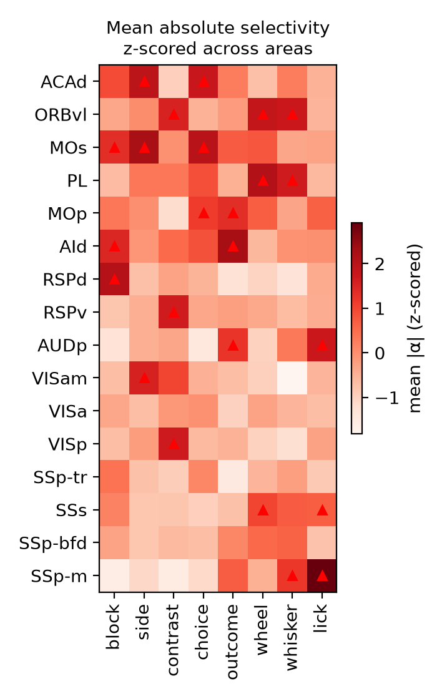

# Selectivity profiles of cortical neurons

How strongly do single neurons in each area of the mouse cortex respond to the
task, behaviour and context variables of the IBL decision-making task?

This repo answers it with a reduced-rank regression (RRR) encoding model
fitted to ~20,000 neurons of the IBL Brain Wide Map. It is a from-scratch
reimplementation of the analysis in Posani, Wang et al., "Rarely categorical,
highly separable representations along the cortical hierarchy", Nature (2026)
([doi](https://doi.org/10.1038/s41586-026-10668-4); authors' code:
[realwsq/brainwide-RRR-encoding-model](https://github.com/realwsq/brainwide-RRR-encoding-model)),
written step by step so that every choice is traceable to the paper or the
authors' code. The final figure corresponds to the paper's Fig. 2c, which we
use as validation.

Each row is a cortical area, each column one of 8 variables (block, stimulus
side, contrast, choice, outcome, wheel, whisking, licking). A cell is the
average selectivity of the area's well-fit neurons to that variable, z-scored
across areas; triangles mark the 3 most selective areas per variable.

## The analysis in brief

1. Each neuron's activity on each trial (-0.2 to 0.8 s around the stimulus,
   10 ms bins) is modelled as a linear combination of the 8 variables, with
   time-varying coefficients.
2. All coefficients' time courses are built from 5 time shapes shared by all
   neurons (the "reduced rank"), so the model can be fitted with a few hundred
   trials per session.
3. Neurons whose held-out trials the model predicts better than their average
   response (delta R² > 0.015) are kept.
4. A neuron's selectivity to a variable is the total size of its coefficient
   over the trial; areas are compared by their neurons' mean selectivity.

## Results

- 170 sessions, 19,728 neurons (4,233 in cortex); 1,739 cortical neurons are
  well fit (41%; the paper: 33%).
- 16 cortical areas have enough well-fit neurons for the figure (the paper
  shows 31): we only have IBL's best-quality units, about 30% of the neurons
  the authors used.
- Of the paper's top-3 areas per variable that fall on areas we have, 10 of 14
  are reproduced; the overall pattern is the paper's (frontal and motor areas
  for choice and stimulus side, medial and frontal areas for the block,
  somatosensory areas and AUDp for licking).

Details, differences and open questions are in [docs/](docs/).

## Running it

Requirements: Python 3.12, and the IBL Brain Wide Map datasets as downloaded
by the IBL AI agent, in a sibling folder:

    git clone https://github.com/int-brain-lab/ibl-ai-agent ../ibl-ai-agent
    # then download bwm_ephys and bwm_behavior (~9 GB) into
    # ../ibl-ai-agent/reports/datasets/, following the agent's README

Create the environment once, from this folder:

    conda create -n selectivity-profiles python=3.12
    conda activate selectivity-profiles
    pip install -r requirements.txt

Then, with the environment active:

    caffeinate -i python run.py agent           # the pipeline: about 1 hour (macOS: keeps the Mac awake)
    python -m analyses.checks agent             # check figures for each stage
    python -m analyses.area_selectivity agent   # Fig. 2c

`agent` is the dataset, defined in `run.py`. The code expects `bwm_ephys`
1.2.1 and `bwm_behavior` 2.0.0; with a newer download, update the `EPHYS` and
`BEHAVIOUR` paths at the top of `pipeline/ibl.py`. A stage whose output exists
is skipped, and the model saves each fit as soon as it is done, so running it
again after an interruption resumes where it left off.

## Pipeline

`run.py` runs four stages, each with its module in `pipeline/` and its
checkpoint in `outputs/<dataset>/`:

| Stage | Module | What it does | Checkpoint |
|---|---|---|---|
| sessions | `sessions.py` (data read by `ibl.py`) | select trials and neurons; bin spikes, wheel, whisking and licks | `sessions/` (~2.5 minutes) |
| inputs | `inputs.py` | smooth and z-score the spikes (y); encode, time-shift and z-score the variables (X) | `inputs/` (~30 seconds) |
| model | `rrr.py` | fit the RRR model: 3 cross-validation fits (held-out R²) and 1 on all trials | `model/` (~1 hour) |
| profiles | `profiles.py` | delta R² against the average-response model; select well-fit neurons; selectivity | `profiles/` (~15 seconds) |

The analyses in `analyses/` read the checkpoints: `checks.py` makes a figure
for each stage (the movement shifts, the learned time shapes of the model, its
R² against the average-response model, and more), `area_selectivity.py` the
paper's Fig. 2c. They are shown and explained stage by stage in
[docs/pipeline.md](docs/pipeline.md). Figures and tables go to
`outputs/<dataset>/results/`, which is kept in the repo; the checkpoints are
regenerated by running the pipeline.

## Documentation

- [docs/pipeline.md](docs/pipeline.md): each stage in detail: what it does and
  why, its output files, results, and how it was validated.
- [docs/differences.md](docs/differences.md): differences from the authors,
  limitations of the method, and open questions.
- [docs/sources.md](docs/sources.md): where every input comes from, and where
  each rule lives in the authors' code.

`requirements.txt` pins the versions the results were produced with.
`ibl-ai-agent` is only used to decode the agent's compressed data files;
`brainwidemap` is a dependency of the agent, only available on GitHub.
