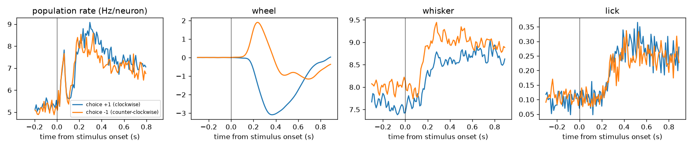
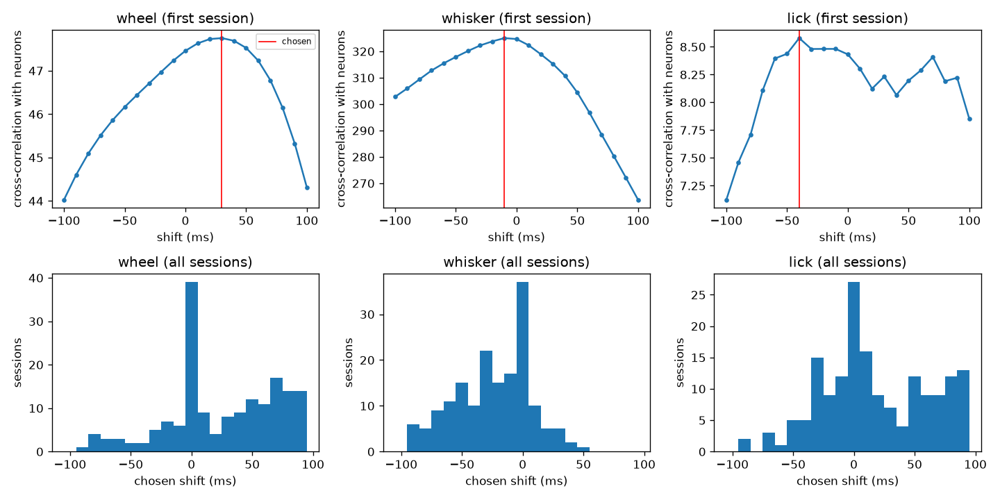
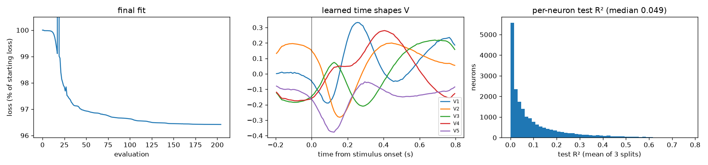
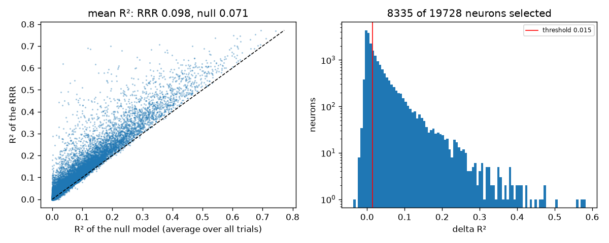
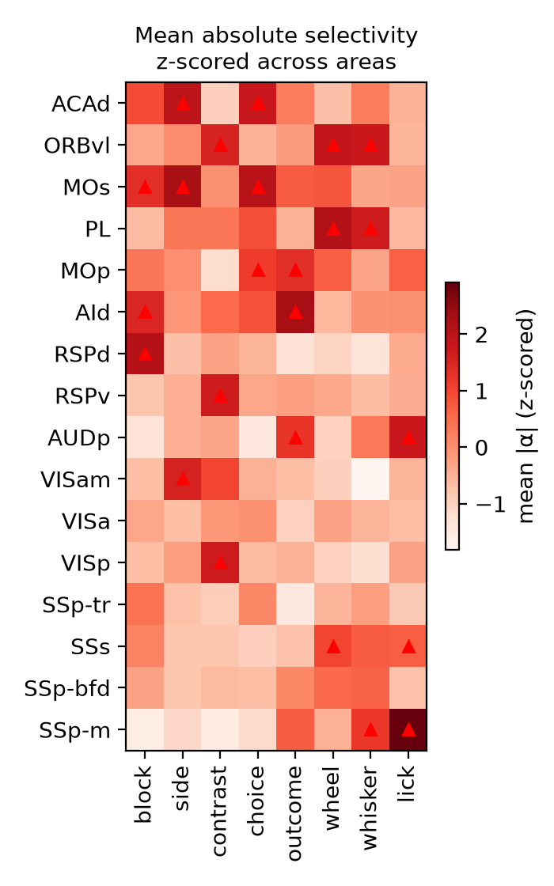

# Pipeline

Five scripts, run in order. Each reads the previous step's files and writes
its own data to `outputs/`, and its figures and tables to `outputs/results/`. Differences from the authors are listed in
[differences.md](differences.md); where each rule comes from, in
[sources.md](sources.md).

## Step 1: build sessions

`step1_build_sessions.py` goes through the authors' sessions and, for each one:

- Trials (`prepare_trials`): keep trials where the mouse made a choice, moved
  after the stimulus, and started and finished its response within 0.8 s;
  drop the 50/50 block. Sessions with fewer than 100 trials left are skipped.
- Neurons (`prepare_neurons`): count spikes in 100 bins of 10 ms, from -0.2 to
  0.8 s around the stimulus. Keep neurons in a real brain area, with a session
  firing rate between 0.5 and 50 Hz, a rate above 0.5 Hz in that window, and
  spikes in at least half of the trials. Units with no area label in the local
  data are what the authors' atlas mapping calls "root", so they are dropped.
  All brain areas are kept, not only cortex: the model's temporal bases are
  shared by every neuron, so the authors fit it on all neurons and only pick
  cortex at the end. Sessions with fewer than 5 neurons are skipped.
- Behaviour (`prepare_behaviour`): wheel velocity, whisker motion energy (max
  of the two cameras) and lick counts, in 120 bins of 10 ms from -0.3 to
  0.9 s. The extra 10 bins on each side let step 2 shift each movement trace
  in time to line it up with the neurons.

Each session is saved to `outputs/sessions/<eid>.npz`, with raw values only:

- `spikes`: spike counts, (trials, 100 bins, neurons).
- `wheel`, `whisker`, `lick`: (trials, 120 bins).
- `trial_id`, `probabilityLeft`, `contrastLeft`, `contrastRight`, `choice`,
  `feedbackType`: one value per trial, as in IBL's trials table. A missing
  (NaN) contrast means no stimulus on that side; choice +1 is a clockwise
  wheel turn and -1 counter-clockwise; feedbackType +1 is a reward.
- `area`, `pid`, `cluster_id`: one value per neuron (Beryl area acronym,
  probe id, IBL cluster id).
- `dt`, `neural_start`: the time axis (0.01 s bins, starting 0.2 s before the
  stimulus). Later steps read it from here instead of redefining it.

Results: 170 of the 172 sessions pass (2 have fewer than 100 trials), with
60,528 trials and 19,728 neurons, of which 4,233 are in cortex. The first
session's signals averaged by choice (`outputs/results/step1_signals_by_choice.png`) look as
expected: the wheel turns in opposite directions for the two choices shortly
after the stimulus, and licks follow the response. numpy prints one harmless
warning: in a few sessions one camera never tracks a tongue tip reliably, so
that camera finds no licks for it; the other camera still does.

Validation: on one session (875c1e5c), the authors' trial and neuron selection
(`filter_trials_func`, `_read_Xy`) gives the same 535 trials and the same 48
neurons as ours.

## Step 2: preprocessing

`step2_preprocess.py` turns each session from step 1 into what the model is
fitted on:

- Targets, y (`prepare_targets`; paper Methods, "Target variables", eq. 1):
  spike counts smoothed in time with a Gaussian (s.d. 20 ms), then z-scored per
  neuron and time bin across trials. Smoothing turns noisy 0/1 spike counts
  into an estimate of the firing rate. Z-scoring puts every neuron and time bin
  on the same scale, so the fit weighs them equally and coefficients can be
  compared across neurons. Because the mean across trials is removed at every
  time bin, y only contains how each trial differs from the average trial;
  that is what the model explains.
- Inputs, X (`prepare_inputs`): the 8 variables at every trial and time bin.
  - Task variables, constant within a trial, encoded as in the paper's Methods
    ("Input variables"): block (+1 = left block, p(left) = 0.8), side (+1 =
    stimulus on the left), contrast (0 for 0%, 1 for low contrast up to 12.5%,
    4 for high), choice (+1 = clockwise), outcome (+1 = reward). The authors'
    code computes the outcome as "stimulus side matches the choice"; we take
    IBL's feedbackType, which is identical in all 60,528 trials.
  - Movement variables (wheel, whisker, lick): neurons and movements are not
    perfectly in sync, so each trace is shifted in time to where it lines up
    best with the session's neurons; one shift per variable and session. The
    paper's Methods only give the idea ("shifted the movement traces so that
    the zero-lagged correlation was maximized", "averaged across neurons and
    trials"). The details come from the authors' code, and we copy them:
    - the shift ranges over +-100 ms, which is what their -0.3 to 0.9 s
      behaviour window allows;
    - the measure is a cross-correlation (their "CC"): for each shift, each
      neuron's dot product with the shifted trace (after removing each trial's
      mean, summed over time, averaged over trials), with the neurons combined
      as the square root of the sum of squares. It is not normalized (values
      are not between -1 and 1), and the neurons are not plainly averaged as
      the Methods' wording suggests: with a plain average, neurons with
      opposite signs would cancel;
    - if the best shift is at the edge of the range (+-100 ms), the search
      counts as failed and the trace is used unshifted.
  - Every variable is then z-scored per time bin across trials, as in the
    paper's Methods (so the coefficients are comparable across variables, and
    the ridge penalty treats them equally). The authors' code also z-scores
    each movement trace over all bins first; the per-bin z-score undoes that,
    so we skip it.

Each session is saved to `outputs/preprocessed/<eid>.npz`:

- `X`: (trials, 100 bins, 8): the 8 variables in this order: block, side,
  contrast, choice, outcome, wheel, whisker, lick.
- `y`: (trials, 100 bins, neurons).
- `y_mean`, `y_std`: (100 bins, neurons), to turn predictions back into
  (smoothed) spike counts.
- `variables`, `area`, `pid`, `cluster_id`, `dt`, `neural_start`: names of
  X's columns, the neuron table and the time axis, passed on from step 1.

Results: the chosen shifts (`outputs/results/step2_shifts.csv`,
`step2_movement_shifts.png`) make sense: neurons tend to fire before the wheel moves
(median +50 ms, motor commands) and after the whiskers move (median -30 ms,
sensing the movement). The shift search fails in 37 sessions for the wheel, 27
for whisker and 19 for lick, and these failures continue the same trends:
almost all wheel failures want more than +100 ms, all whisker failures less
than -100 ms. So the +-100 ms range of the authors' code is too narrow for
some sessions; we keep it and the failure rule, to match them (see
[differences.md](differences.md), Limitations).

Validation: on 5 sessions, against the authors' `find_bestdelay_byCC` and
`_read_Xy`: y is identical, X equal to within 3e-7 (rounding), and every chosen
shift is the same.

## Step 3: fitting the RRR model

`step3_fit_rrr.py` fits the encoding model to all neurons of all sessions at
once.

- The model (`RRR`; paper Methods, eq. 2-3): each neuron's z-scored activity
  is a linear combination of the 8 variables, with time-varying coefficients,
  plus a baseline per neuron and time bin:
  `y_hat[n](k, t) = sum_v beta[n, v](t) * x[v](k, t) + b[n](t)`. Since X and
  y are z-scored, a coefficient reads: at time t, when variable v is 1 std
  above usual, neuron n's activity is beta[n, v](t) std above usual. Every
  coefficient's time course is a mix of a few time shapes shared by all
  neurons and sessions: `beta[n, v](t) = sum_i U[n, v, i] * V[i](t)`. This
  reduced rank is what makes the fit possible with few trials: 8 x 5 = 40
  numbers per neuron instead of 8 x 100, and every neuron helps estimate V.
  This is why all brain areas are fitted, not only cortex.
- The fit (`fit`; paper Methods, eq. 7): minimize the squared prediction error
  plus a ridge penalty, lambda times the sum of all beta² (the baseline is not
  penalized), with L-BFGS and the authors' settings, over all sessions together.
- No hyperparameter search: d = 5 shapes (the paper's best) and lambda = 75
  (see [differences.md](differences.md)).
- It is fitted twice over:
  - 3 times on 70% of each session's trials, measuring each neuron's R² on the
    other 30%, trials the model never saw (`test_r2`). Averaged over the 3
    splits, this is the honest goodness of fit that step 4 uses to keep the
    well-fit neurons (paper Methods: "We repeated the whole
    split-train-test process three times"). The test fraction is 0.3 as in
    the authors' code; the paper says one-third.
  - once on all trials. Its coefficients are what step 5 summarizes.
- The splits are stratified by block x contrast, so every combination is in
  both parts (paper Methods); if a session has too few trials of some
  combination, by block only, then not at all (authors' code). The paper
  doesn't say why only these two variables. Our reading: they are set by the
  experimenter rather than by the mouse's behaviour, they are the ones most
  likely to be unbalanced by chance (blocks come in long runs; 0% contrast is
  ~10% of trials), and adding more variables would leave too few trials per
  combination to split.
- R² is computed on spike counts: the data and the predictions are
  un-z-scored first (authors' code). The two versions differ. Per neuron,
  with s(t) and m(t) the std and mean across trials at time bin t, the errors
  in counts are the z-scored errors weighted by s(t)², and the total variation
  in counts is K * sum_t s(t)² (trial-to-trial) + K * sum_t (m(t) - mean)² (the
  average response over time). So on spike counts the average response also
  counts as explained, and R² is higher than on z-scored data. We use spike
  counts because the paper's goodness of fit and its threshold on R² minus the
  average-response model's R² (step 4) are defined on firing rates.

Output, in `outputs/rrr/`:

- `split0.npz`, `split1.npz`, `split2.npz`: for each session id, one test R²
  per neuron (same order as in step 2's files); `losses`, the fit's loss after
  every evaluation.
- `all_trials.npz`: the final model. `V` (5 shapes x 100 bins); for each
  session `U_<eid>` (neurons x 8 variables x 5) and `b_<eid>` (neurons x 100
  bins); `losses`. The coefficients are beta = U @ V.

Each fit is saved as soon as it is done and skipped if its file exists, so an
interrupted run resumes where it stopped (delete `outputs/rrr/` to start over).

Results: about 1 hour on a 16 GB M3 laptop. Every fit converged long before
the 1000-iteration limit (205 to 358 evaluations). The 5 learned shapes
(`outputs/results/step3_fit.png`) are smooth and follow the task's timeline:
flat before the stimulus, with features around the stimulus response
(~0.1 s), the movement (~0.2-0.3 s) and after the response (~0.4 s and
later). Nothing in the model forces them to be smooth: each time bin of V is
free, and the smoothness comes from the smoothed data, the pooling over all
neurons and the convergence of the fit. Individual shapes are not unique
(other sets of 5 give the same coefficients), so only the coefficients are
interpreted. The per-neuron test R² has a median of 0.049 and a long tail up
to ~0.7; it includes the part the average response explains, which step 4
subtracts.

Validation: the model, the loss and the initialization scheme follow the
authors' `RRRGD_model`. A preliminary fit on all trials was inspected before
the full run (converging loss, smooth time shapes), and a reduced run (3
sessions, 10 iterations) covered saving and resuming.

## Step 4: goodness of fit and selection

`step4_select_neurons.py` decides which neurons the selectivity analysis uses.

- R² of the RRR: each neuron's test R² from step 3, averaged over the 3 splits.
- R² of the null model (`null_r2`; paper Methods, eq. 8): the null model
  predicts every test trial with the average response of the training trials,
  one value per time bin, ignoring the 8 variables. It uses the same splits
  and the same R² as the RRR, imported from step 3.
- delta R² = R²(RRR) - R²(null) (paper Methods, eq. 9): what the 8 variables
  add beyond the average response. Both R²'s include the part the average
  response explains on spike counts, so it cancels here.
- A neuron is selected if delta R² > 0.015. The paper's Methods write >= 0.015;
  the authors' code uses >, which we follow (with continuous R² values the
  difference is negligible).

Output, in `outputs/neurons/`:

- `table.csv`: one row per neuron: `eid`, `pid`, `cluster_id`, `area`,
  `r2_rrr`, `r2_null`, `delta_r2`, `selected`.
- `beta.npy`: the coefficients of the final fit, beta = U @ V,
  (neurons, 8 variables, 100 time bins), in the same row order as the table.

Results: almost every neuron is predicted better by the RRR than by the null
model (`outputs/results/step4_r2_vs_null.png`). 8,335 of the 19,728 neurons are
selected; in cortex, 1,739 of 4,233 (41%; the paper: 4,617 of about 14,000,
33%). 16 cortical areas have at least 30 selected neurons, the minimum to
appear in step 5 (the paper shows 31): ACAd, AId, AUDp, MOp, MOs, ORBvl, PL,
RSPd, RSPv, SSp-bfd, SSp-m, SSp-tr, SSs, VISa, VISam, VISp. 3,342 neurons have
a negative delta R²: the RRR predicts their unseen trials worse than the
average does, i.e. they have no real selectivity.

Validation: the null model and the selection follow the authors'
`trial_avg_r2` and `Fig2c.py`; the splits and R² are step 3's own functions.

## Step 5: area selectivity (the paper's Fig. 2c)

`step5_area_selectivity.py` makes the figure, as the authors' `Fig2c.py` does.

- Selectivity of each neuron to each variable (paper Methods, "Computing the
  selectivity profiles"): alpha = sum over the 100 time bins of |beta(t)|,
  the total modulation over the trial. The absolute value makes effects of
  opposite sign (or in opposite directions at different times) add up instead
  of cancelling, and makes the arbitrary sign coding of the variables
  irrelevant: alpha measures how strongly a neuron is modulated, not in which
  direction.
- Neurons: the selected ones (step 4) in the 43 cortical areas. Areas: those
  with at least 30 such neurons (authors' code).
- Each area's alpha is averaged over its neurons and z-scored across areas,
  separately for each variable. Variables differ in how strongly they
  modulate neurons overall (whisking modulates nearly everything more than the
  block does); z-scoring per variable removes that, so each column shows which
  areas stand out for that variable. Colours compare areas within a column,
  not variables, and depend on which areas are shown.
- Areas are ordered as in the authors' code: grouped by family
  (somatosensory, visual, auditory and gustatory, retrosplenial, insular,
  others), each in hierarchy order, then reversed. The 3 most selective areas
  of each variable are marked with triangles, as in the published figure (the
  authors' code uses "*").

Output, in `outputs/results/`: `step5_area_selectivity.png`, and
`step5_area_selectivity.csv` with the z-scored values and each area's number of
selected neurons.

Results: 16 areas, from 1,403 selected cortical neurons. With 16 of the
paper's 31 areas, the fair comparison is the paper's top-3 markers that fall
on areas we have: 10 of those 14 are reproduced. Side (MOs, ACAd), choice
(MOs, ACAd), outcome (AId, AUDp), wheel (PL, SSs) and lick (AUDp) match
fully; block matches 1 of 3 (RSPd; ACAd and RSPv come just below); whisker
matches 0 of 2 (SSs and SSp-bfd are high but not top; the frontal ORBvl and
PL come first); none of the paper's contrast markers are in our areas (VISp
leads among ours). The overall pattern is the paper's: frontal and motor areas
lead the cognitive and choice variables, medial and frontal areas the block,
somatosensory areas and AUDp the licking. Likely causes of the differences:
fewer neurons per area (noisier averages), good units only, one movement
shift per session, and lambda not searched.

