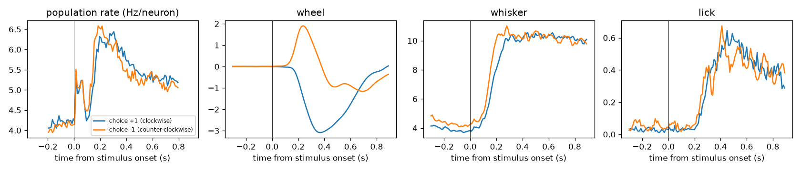
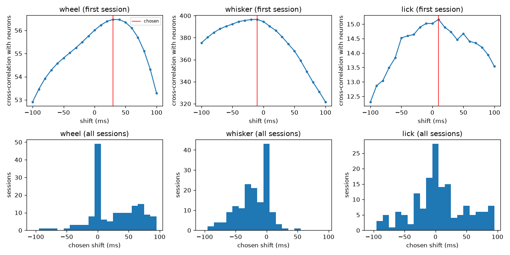
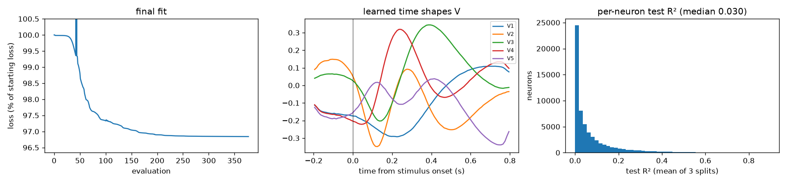
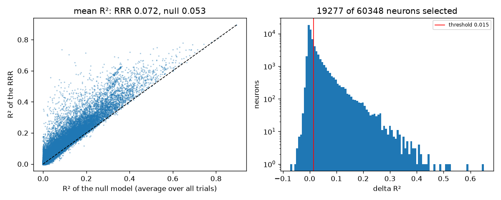
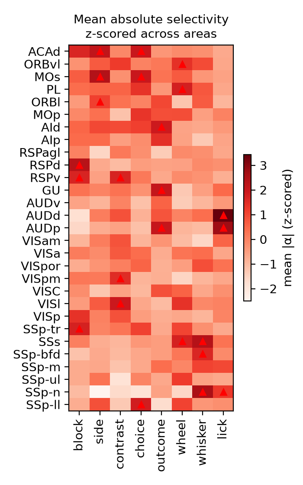

# Pipeline

`run.py <dataset>` runs four stages in order, each with its module in
`pipeline/`. Each stage reads the previous stage's checkpoint and writes its
own to `outputs/<dataset>/`; a stage whose checkpoint exists is skipped. As
each stage ends, `run.py` draws its check figure (`analyses/checks.py`), shown
below, and puts it with the stages' summary tables in
`outputs/<dataset>/results/pipeline/`. The analyses in `analyses/` read the
checkpoints and write to a folder of their own in `outputs/<dataset>/results/`:
`area_selectivity.py`, the mean selectivity per area, and
`compare_posani_wang.py`, the comparison with Posani-Wang's trained model. The
results below are for the `shuqi` dataset (IBL's data as Posani-Wang had it). Differences from
Posani-Wang are listed in [differences.md](differences.md); where each rule
comes from, in [sources.md](sources.md).

## Sessions

`pipeline/ibl.py` reads each of the dataset's sessions from IBL's server, each
file in its last revision dated on or before the dataset's date: the trials table, each probe's neurons
(all units, or only IBL's good units) with their spikes and Beryl area, the
wheel position (interpolated at 100 Hz), each camera's whisker motion energy,
and IBL's lick times. `pipeline/sessions.py` then, for each session:

- Trials (`prepare_trials`): keep trials where the mouse made a choice, moved
  after the stimulus, and started and finished its response within 0.8 s;
  drop the 50/50 block. Sessions with fewer than 100 trials left are skipped.
- Neurons (`prepare_neurons`): count spikes in 100 bins of 10 ms, from -0.2 to
  0.8 s around the stimulus. Keep neurons in a real brain area, with a session
  firing rate between 0.5 and 50 Hz, a rate above 0.5 Hz in that window, and
  spikes in at least half of the trials. Units in "root" or "void" (no area)
  or in "y" (a fiber tract) are dropped.
  All brain areas are kept, not only cortex: the model's temporal bases are
  shared by every neuron, so Posani-Wang fits it on all neurons and only picks
  cortex at the end. Sessions with fewer than 5 neurons are skipped.
- Behaviour (`prepare_behaviour`): wheel velocity, whisker motion energy (max
  of the two cameras) and lick counts, in 120 bins of 10 ms from -0.3 to
  0.9 s. The extra 10 bins on each side let the inputs shift each movement trace
  in time to line it up with the neurons.

Each session is saved to `outputs/<dataset>/sessions/<eid>.npz`, with raw values only:

- `spikes`: spike counts, (trials, 100 bins, neurons).
- `wheel`, `whisker`, `lick`: (trials, 120 bins).
- `trial_id`, `probabilityLeft`, `contrastLeft`, `contrastRight`, `choice`,
  `feedbackType`: one value per trial, as in IBL's trials table. A missing
  (NaN) contrast means no stimulus on that side; choice +1 is a clockwise
  wheel turn and -1 counter-clockwise; feedbackType +1 is a reward.
- `area`, `pid`, `cluster_id`, `uuid`: one value per neuron (Beryl area
  acronym, probe id, IBL cluster id, IBL's id of the neuron).
- `dt`, `neural_start`, `behav_start`: the time axis (0.01 s bins, starting
  0.2 s before the stimulus for the spikes and 0.3 s for the behaviour). Later
  stages read it from here instead of redefining it.

Results: 157 of the 178 sessions pass (18 excluded by hand, 3 with fewer than
100 trials; `results/pipeline/sessions.csv`), with 55,581 trials and 60,348
neurons, of which 14,526 are in cortex. The first session's signals averaged
by choice (`results/pipeline/signals_by_choice.png`) look as expected: the
wheel turns in opposite directions for the two choices shortly after the
stimulus, and licks follow the response.

Validation: on one session (875c1e5c, good units only), Posani-Wang's trial and
neuron selection (`filter_trials_func`, `_read_Xy`) gives the same 535 trials
and the same 48 neurons as ours. Across all sessions, the neurons are compared
with Posani-Wang's trained model below.

## Inputs

`pipeline/inputs.py` turns each session from the sessions stage into what the model
is fitted on:

- Targets, y (`prepare_targets`; Posani-Wang Methods, "Target variables", eq. 1):
  spike counts smoothed in time with a Gaussian (s.d. 20 ms), then z-scored per
  neuron and time bin across trials. Smoothing turns noisy 0/1 spike counts
  into an estimate of the firing rate. Z-scoring puts every neuron and time bin
  on the same scale, so the fit weighs them equally and coefficients can be
  compared across neurons. Because the mean across trials is removed at every
  time bin, y only contains how each trial differs from the average trial;
  that is what the model explains.
- Inputs, X (`prepare_inputs`): the 8 variables at every trial and time bin.
  - Task variables, constant within a trial, encoded as in the Posani-Wang Methods
    ("Input variables"): block (+1 = left block, p(left) = 0.8), side (+1 =
    stimulus on the left), contrast (0 for 0%, 1 for low contrast up to 12.5%,
    4 for high), choice (+1 = clockwise), outcome (+1 = reward). Posani-Wang's
    code computes the outcome as "stimulus side matches the choice"; we take
    IBL's feedbackType, which is identical in all 60,528 trials.
  - Movement variables (wheel, whisker, lick): neurons and movements are not
    perfectly in sync, so each trace is shifted in time to where it lines up
    best with the session's neurons; one shift per variable and session. The
    Posani-Wang Methods only give the idea ("shifted the movement traces so that
    the zero-lagged correlation was maximized", "averaged across neurons and
    trials"). The details come from the Posani-Wang code, and we copy them:
    - the shift ranges over +-100 ms, which is what their -0.3 to 0.9 s
      behaviour window allows;
    - the measure is a cross-correlation (their "CC"): for each shift, each
      neuron's dot product with the shifted trace (after removing each trial's
      mean, summed over time, averaged over trials), with the neurons combined
      as the square root of the sum of squares. It is not normalized (values
      are not between -1 and 1), and the neurons are not plainly averaged as
      the Methods' wording suggests: with a plain average, neurons with
      opposite signs would cancel;
    - if the best shift is at the edge of the range (+-100 ms), the search
      counts as failed and the trace is used unshifted.
  - Every variable is then z-scored per time bin across trials, as in the
    Posani-Wang Methods (so the coefficients are comparable across variables, and
    the ridge penalty treats them equally). The Posani-Wang code also z-scores
    each movement trace over all bins first; the per-bin z-score undoes that,
    so we skip it.

Each session is saved to `outputs/<dataset>/inputs/<eid>.npz`:

- `X`: (trials, 100 bins, 8): the 8 variables in this order: block, side,
  contrast, choice, outcome, wheel, whisker, lick.
- `y`: (trials, 100 bins, neurons).
- `y_mean`, `y_std`: (100 bins, neurons), to turn predictions back into
  (smoothed) spike counts.
- `wheel_cross_corr`, `whisker_cross_corr`, `lick_cross_corr`: each
  movement's cross-correlation for every shift (for the check figure).
- `variables`, `area`, `pid`, `cluster_id`, `uuid`, `dt`, `neural_start`: names of
  X's columns, the neuron table and the time axis, passed on from the sessions stage.

Results: the chosen shifts (`results/pipeline/shifts.csv`,
`results/pipeline/movement_shifts.png`) make sense: neurons tend to fire before the wheel moves
(median +40 ms, motor commands) and after the whiskers move (median -20 ms,
sensing the movement). The shift search fails in 44 of the 157 sessions for
the wheel, 22 for whisker and 14 for lick, and these failures continue the
same trends: 37 of the 44 wheel failures want more than +100 ms, all whisker
failures less than -100 ms. So the +-100 ms range of the Posani-Wang code is
too narrow for some sessions; we keep it and the failure rule, to match them
(see [differences.md](differences.md), Limitations).

Validation: on 5 sessions, against Posani-Wang's `find_bestdelay_byCC` and
`_read_Xy`: y is identical, X equal to within 3e-7 (rounding), and every chosen
shift is the same.

## Model

`pipeline/rrr.py` fits the encoding model to all neurons of all sessions at
once.

- The model (`RRR`; Posani-Wang Methods, eq. 2-3): each neuron's z-scored activity
  is a linear combination of the 8 variables, with time-varying coefficients,
  plus a baseline per neuron and time bin:
  `y_hat[n](k, t) = sum_v beta[n, v](t) * x[v](k, t) + b[n](t)`. Since X and
  y are z-scored, a coefficient reads: at time t, when variable v is 1 std
  above usual, neuron n's activity is beta[n, v](t) std above usual. Every
  coefficient's time course is a mix of a few time shapes shared by all
  neurons and sessions: `beta[n, v](t) = sum_i U[n, v, i] * V[i](t)`. This
  reduced rank is what makes the fit possible with few trials: 8 x 5 = 40
  numbers per neuron instead of 8 x 100, and every neuron helps estimate V.
  This is why all brain areas are fitted, not only cortex.
- The fit (`fit`; Posani-Wang Methods, eq. 7): minimize the squared prediction error
  plus a ridge penalty, lambda times the sum of all beta² (the baseline is not
  penalized), with L-BFGS and Posani-Wang's settings, over all sessions together.
- No hyperparameter search: d = 5 shapes (Posani-Wang's best) and lambda = 25,
  the value their cross-validation criterion picks and that reproduces their
  trained model (see [differences.md](differences.md)).
- It is fitted twice over:
  - 3 times on 70% of each session's trials, measuring each neuron's R² on the
    other 30%, trials the model never saw (`cross_validated_r2`). Averaged over the 3
    splits, this is the honest goodness of fit that the profiles use to keep the
    well-fit neurons (Posani-Wang Methods: "We repeated the whole
    split-train-test process three times"). The test fraction is 0.3 as in
    the Posani-Wang code; Posani-Wang says one-third.
  - once on all trials (`fit_all_trials`). Its coefficients are the profiles'.
- The splits are stratified by block x contrast, so every combination is in
  both parts (Posani-Wang Methods); if a session has too few trials of some
  combination, by block only, then not at all (Posani-Wang code). Posani-Wang
  doesn't say why only these two variables. Our reading: they are set by the
  experimenter rather than by the mouse's behaviour, they are the ones most
  likely to be unbalanced by chance (blocks come in long runs; 0% contrast is
  ~10% of trials), and adding more variables would leave too few trials per
  combination to split.
- R² is computed on spike counts: the data and the predictions are
  un-z-scored first (Posani-Wang code). The two versions differ. Per neuron,
  with s(t) and m(t) the std and mean across trials at time bin t, the errors
  in counts are the z-scored errors weighted by s(t)², and the total variation
  in counts is K * sum_t s(t)² (trial-to-trial) + K * sum_t (m(t) - mean)² (the
  average response over time). So on spike counts the average response also
  counts as explained, and R² is higher than on z-scored data. We use spike
  counts because Posani-Wang's goodness of fit and its threshold on R² minus the
  average-response model's R² (the profiles) are defined on firing rates.

Output, in `outputs/<dataset>/model/`:

- `split0.npz`, `split1.npz`, `split2.npz`: for each session id, one test R²
  per neuron (same order as in the inputs' files); `losses`, the fit's loss after
  every evaluation.
- `all_trials.npz`: the final model. `V` (5 shapes x 100 bins); for each
  session `U_<eid>` (neurons x 8 variables x 5) and `b_<eid>` (neurons x 100
  bins); `losses`. The coefficients are beta = U @ V.

Each fit is saved as soon as it is done and skipped if its file exists, so an
interrupted run resumes where it stopped (delete `outputs/<dataset>/model/` to start over).

Results: about half an hour on a 16 GB M3 laptop. Every fit converged long before
the 1000-iteration limit (350 to 441 evaluations). The 5 learned shapes
(`results/pipeline/fit.png`) are smooth and follow the task's timeline:
flat before the stimulus, with features around the stimulus response
(~0.1 s), the movement (~0.2-0.3 s) and after the response (~0.4 s and
later). Nothing in the model forces them to be smooth: each time bin of V is
free, and the smoothness comes from the smoothed data, the pooling over all
neurons and the convergence of the fit. Individual shapes are not unique
(other sets of 5 give the same coefficients), so only the coefficients are
interpreted. The per-neuron test R² has a median of 0.030 and a long tail up
to ~0.9; it includes the part the average response explains, which the
profiles subtract.

Validation: the model, the loss and the initialization scheme follow
Posani-Wang's `RRRGD_model`. A preliminary fit on all trials was inspected before
the full run (converging loss, smooth time shapes), and a reduced run (3
sessions, 10 iterations) covered saving and resuming.

## Profiles

`pipeline/profiles.py` decides which neurons the selectivity analyses use, and
defines their selectivity.

- R² of the RRR: each neuron's test R² from the model stage, averaged over the 3 splits.
- R² of the null model (`null_r2`; Posani-Wang Methods, eq. 8): the null model
  predicts every test trial with the average response of the training trials,
  one value per time bin, ignoring the 8 variables. It uses the same splits
  and the same R² as the RRR, imported from `pipeline/rrr.py`.
- delta R² = R²(RRR) - R²(null) (Posani-Wang Methods, eq. 9): what the 8 variables
  add beyond the average response. Both R²'s include the part the average
  response explains on spike counts, so it cancels here.
- A neuron is selected if delta R² > 0.015. The Posani-Wang Methods write >= 0.015;
  the Posani-Wang code uses >, which we follow (with continuous R² values the
  difference is negligible).

Output, in `outputs/<dataset>/profiles/`:

- `table.csv`: one row per neuron: `eid`, `pid`, `cluster_id`, `uuid`, `area`,
  `r2_rrr`, `r2_null`, `delta_r2`, `selected`.
- `beta.npy`: the coefficients of the final fit, beta = U @ V,
  (neurons, 8 variables, 100 time bins), in the same row order as the table.

Results: 19,277 of the 60,348 neurons are selected (`results/pipeline/r2_vs_null.png`); in
cortex, 4,381 of 14,526 (30%; Posani-Wang's trained model: 4,617 of 14,283,
32%). 29 cortical areas have at least 30 selected neurons, the minimum to
appear in the area selectivity figure (Posani-Wang's Fig. 2c shows 31).
16,732 neurons have a negative delta R²: the RRR predicts their unseen trials
worse than the average does, i.e. they have no real selectivity. With all
units, many of them are weak or noisy units.

Validation: the null model and the selection follow Posani-Wang's
`trial_avg_r2` and `Fig2c.py`; the splits and R² are the model's own functions.

## Analysis: area selectivity

`analyses/area_selectivity.py` makes the figure, as Posani-Wang's `Fig2c.py`
does for their Fig. 2c.

- Selectivity of each neuron to each variable (Posani-Wang Methods, "Computing the
  selectivity profiles"; `profiles.alpha`): alpha = sum over the 100 time bins of |beta(t)|,
  the total modulation over the trial. The absolute value makes effects of
  opposite sign (or in opposite directions at different times) add up instead
  of cancelling, and makes the arbitrary sign coding of the variables
  irrelevant: alpha measures how strongly a neuron is modulated, not in which
  direction.
- Neurons: the selected ones (the profiles) in the 43 cortical areas. Areas: those
  with at least 30 such neurons (Posani-Wang code).
- Each area's alpha is averaged over its neurons and z-scored across areas,
  separately for each variable. Variables differ in how strongly they
  modulate neurons overall (whisking modulates nearly everything more than the
  block does); z-scoring per variable removes that, so each column shows which
  areas stand out for that variable. Colours compare areas within a column,
  not variables, and depend on which areas are shown.
- Areas are ordered as in the Posani-Wang code: grouped by family
  (somatosensory, visual, auditory and gustatory, retrosplenial, insular,
  others), each in hierarchy order, then reversed. The 3 most selective areas
  of each variable are marked with triangles, as in the published figure (the
  Posani-Wang code uses "*").

Output, in `outputs/<dataset>/results/area_selectivity/`: `area_selectivity.png`, and
`area_selectivity.csv` with the z-scored values and each area's number of
selected neurons.

Results: 29 areas, from 4,189 selected cortical neurons. Compared with the
same figure made from Posani-Wang's trained model in the validation below.

## Validation against Posani-Wang's model

`analyses/compare_posani_wang.py` compares the `shuqi` dataset with
Posani-Wang's trained model, neuron by neuron (matched by IBL id), one figure
per step, in `outputs/shuqi/results/compare_posani_wang/` with the numbers in
`numbers.csv`. Red, in every figure: the 11 sessions whose neurons differ
(an open question, [differences.md](differences.md)). Where two numbers are
given, the second leaves them out.

- Data (`1_data.png`): 157 sessions in both; 56,854 of their 57,202 neurons in
  them (99.4%), all in the same area; the same neurons in 146 sessions. Null
  model's R²: mean 0.052 for both, r = 0.972 / 0.994.
- Fit (`2_fit.png`): mean test R² 0.071 against 0.072, r = 0.969 / 0.995 (our
  model against itself across the 3 splits: 0.978); delta R², r = 0.953 /
  0.981. The selection is the same for 92.8% / 93.3% of the neurons: 16,614
  selected by both, 1,540 only by ours, 2,559 only by theirs.
- Profiles (`3_profiles.png`), on the 16,614 selected by both: alpha r =
  0.92-0.98 per variable (0.93-0.99 without the red); ours 11-24% larger, from
  lambda ([differences.md](differences.md)); each neuron's profile shape,
  median cosine similarity 0.996 (0.817 in the red, the chance level).
- Areas (`4_areas.png`): the area selectivity figure from their model and
  ours. From all of each model's neurons: 31 and 29 areas, r = 0.92 on the 28
  in both, 18 of the 24 top-3 markers shared. From the 146 sessions with the
  same neurons: r = 0.97, 22 of 24. The areas only one figure shows come from
  data: VISal (all of their selected neurons in sessions we don't have),
  AUDpo (26 of 39 in those sessions, 11 in the red ones), RSPagl (33 of our 44
  in the red ones), and AIv (26 against 30 selected neurons, at the threshold).
- Population profiles (`5_population.png`, suggested by Shuqi Wang): for each
  session and variable, the cosine similarity of its neurons' alpha, ours
  against theirs: median 0.994 (minimum 0.936) in the 146 sessions, 0.785 in
  the red ones (0.78 with the neurons shuffled: alpha are positive, so the
  chance level is high).

So the implementation reproduces Posani-Wang's model on the same data, up to
a scale of alpha that the analyses don't use.
